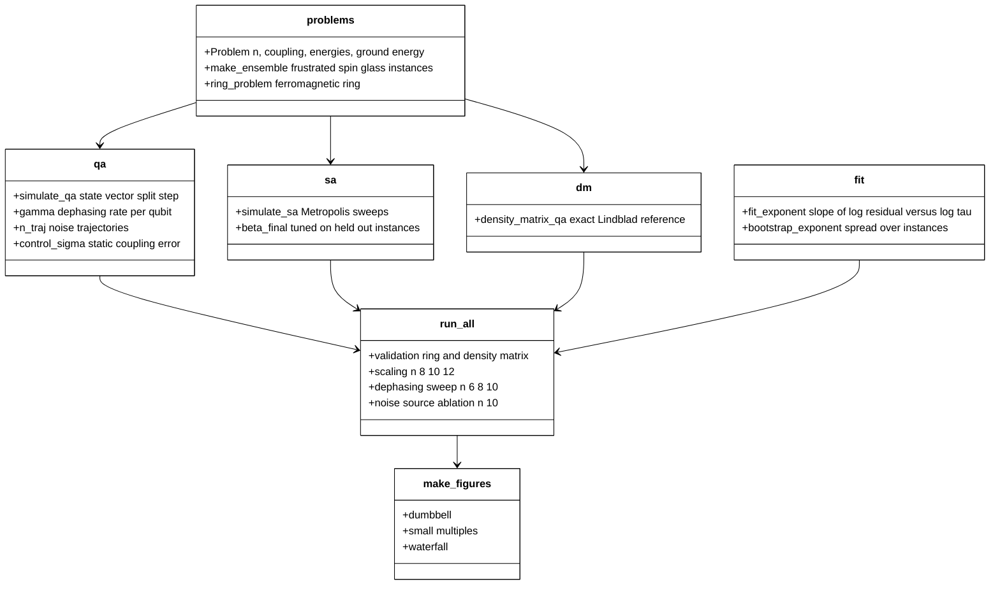
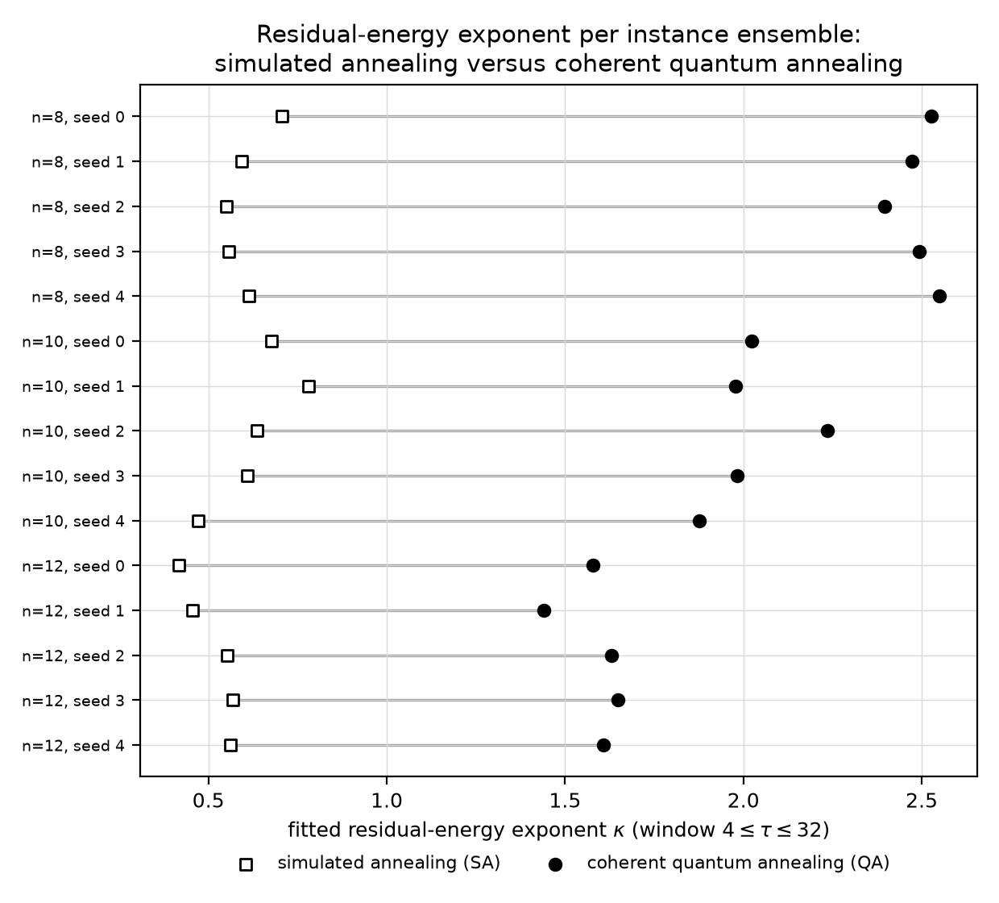
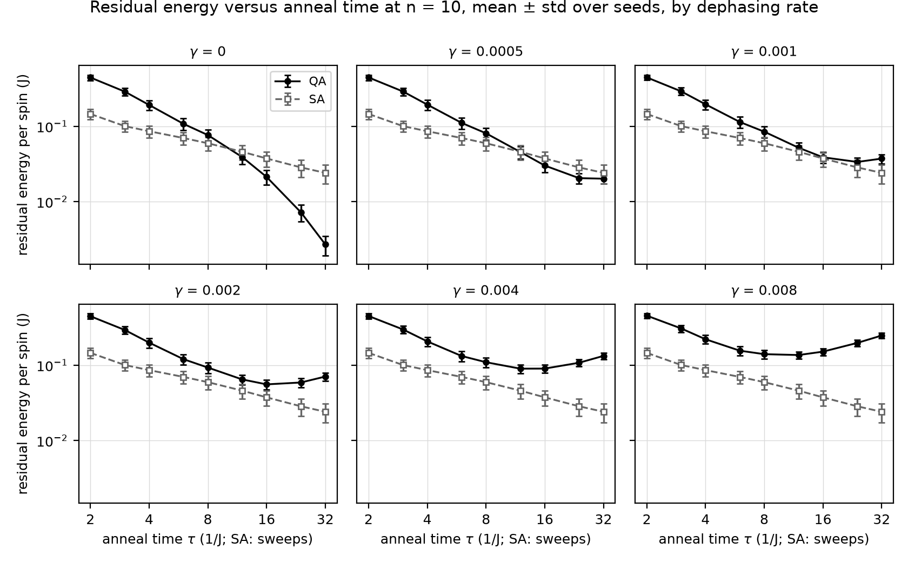
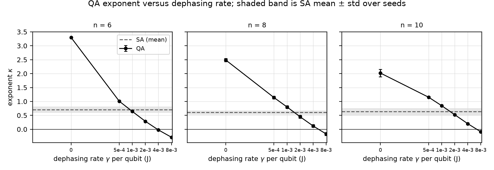
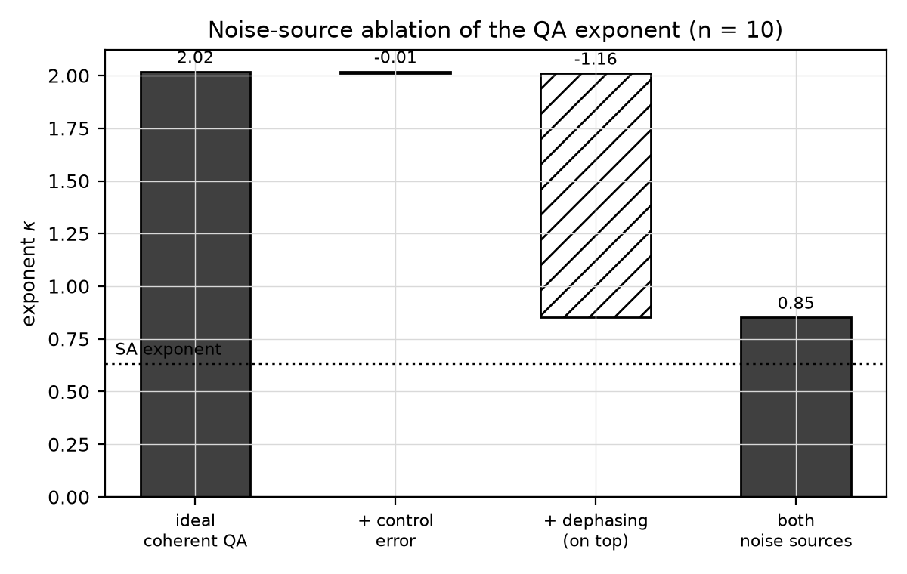

# How much dephasing can a spin-glass annealing exponent tolerate?


[](https://github.com/pradeepdegalaroyal/quantum-annealing-exponent-dephasing-spin-glass/actions/workflows/ci.yml)

**Research question.** Coherent quantum annealing (QA) of a frustrated spin glass lowers its residual energy with anneal time much faster than simulated annealing (SA) does. How much single-qubit dephasing can that exponent tolerate before it is no better than SA's?

**One-line answer (simulation, n = 6 to 12 qubits).** The coherent exponent beats the SA exponent in 15 of 15 instance ensembles, but a dephasing rate of only about 1e-3 per qubit (in units of the coupling J) brings it down to the SA value. The break-even rate does not fall with system size in this range: it is 0.00092, 0.00157 and 0.00169 for n = 6, 8, 10.

## Abstract

I simulate a transverse-field annealer on frustrated plus-or-minus-J spin glasses with exact state vectors and a trajectory model of Z-dephasing that is validated against the exact density matrix. The fitted residual-energy exponent of coherent QA exceeds that of a tuned Metropolis SA baseline in every seed at n = 8, 10 and 12, but the QA exponent itself falls with n (2.49, 2.02, 1.58) and is removed almost entirely by dephasing, whereas a 10 % static coupling error costs nothing measurable. All numbers are simulations on at most 12 qubits; no quantum advantage is claimed.

## Motivation

Large annealers are used to probe quantum-critical dynamics of spin glasses, and the evidence for a scaling advantage over Monte Carlo (MC) relies on exponents (King et al., 2023, doi:10.1038/s41586-023-05867-2). Random-circuit and annealing dynamics are a central testbed for non-equilibrium many-body physics (Fisher et al., 2023, doi:10.1146/annurev-conmatphys-031720-030658). Hardware papers report gate error rates and whether error correction can extend coherence in practice (Sivak et al., 2023, doi:10.1038/s41586-023-05782-6; Bluvstein et al., 2024, doi:10.1038/s41586-023-06927-3; Evered et al., 2023, doi:10.1038/s41586-023-06481-y; Ma et al., 2023, doi:10.1038/s41586-023-06438-1), but not what a residual dephasing rate does to a slow analogue sweep. Simulating the process classically before a hardware run is a recognised step (Nguyen et al., 2027, doi:10.1007/978-981-92-2587-3_22).

## Research gap

The exponent is only a fair discriminator if the classical competitor is tuned in the same window and the quantum exponent survives realistic decoherence. The supplied literature does not quantify the latter for annealing. The full related-work table (12 papers, four roles) and the derivation are in [`docs/RESEARCH_GAP.md`](docs/RESEARCH_GAP.md). The design is in [`docs/METHOD.md`](docs/METHOD.md).

### What is new here
- A measurement of the dephasing rate gamma* at which the QA exponent falls to a tuned SA exponent, per system size, with per-seed spread.
- A trajectory model of Z-dephasing checked against the exact density matrix, so that the sweep extends beyond sizes where density matrices are affordable.
- A noise-source ablation separating dephasing from static control error on the exponent.
- Negative findings stated openly: the hypothesised decrease of gamma* with n is not observed, and the QA exponent shrinks with n.

### Hypotheses
- H1: coherent QA has a larger exponent than tuned SA at n = 8, 10, 12 in at least 4 of 5 seeds. **Supported (5 of 5 at each n).**
- H2: gamma* is finite on the grid and decreases with n. **Finite: yes. Decreasing: not supported** (it increases from n = 6 to 8 and is flat within spread from 8 to 10).
- H3: dephasing removes more exponent than a 10 % static coupling error. **Supported.**

## Method

Anneal Hamiltonian H(s) = -(1 - s) sum_k X_k + s H_P with s = t / tau, linear schedule, tau in units of 1/J. H_P is a frustrated plus-or-minus-J Ising model on a random 3-regular graph (6 instances per seed, 5 seeds). Coherent evolution is an exact state-vector second-order split step on a graphics processing unit (GPU). Dephasing uses the Lindblad operator sqrt(gamma) Z_k on every qubit, unravelled as white-noise phase kicks and averaged over 50 to 100 trajectories. The SA baseline is Metropolis single-spin-flip with a linear inverse-temperature ramp (final value tuned on held-out instances, 1000 replicas), with one sweep identified with one unit of 1/J. The exponent kappa is the slope of log residual energy against log tau in the window 4 <= tau <= 32 (fixed in advance, 9 anneal times).



Legend: QA = quantum annealing, SA = simulated annealing, `dm` = exact density-matrix reference, Lindblad = Markovian open-system master equation, `run_all` = the one-command experiment driver, tau = anneal time, kappa = fitted exponent.

## Results

All values are mean ± standard deviation over 5 seeds (each seed draws its own 6 instances); source files are in `results/`.

### Coherent QA versus tuned SA

| n | kappa QA | kappa SA | seeds with QA above SA | anneal time where QA overtakes SA (1/J) |
|---|---|---|---|---|
| 8 | 2.49 ± 0.06 | 0.60 ± 0.06 | 5 of 5 | 8.7 ± 1.2 |
| 10 | 2.02 ± 0.13 | 0.63 ± 0.11 | 5 of 5 | 10.4 ± 2.2 |
| 12 | 1.58 ± 0.08 | 0.51 ± 0.07 | 5 of 5 | 10.2 ± 1.1 |

Source: `results/coherent_exponents.csv`, `results/summary.json`. The tuned final inverse temperature of SA was 3 for every n.



*Figure 1. In every one of the 15 instance ensembles the coherent exponent (filled circle) lies to the right of the SA exponent (open square); the gap shrinks as n grows.*

### Dephasing sweep and break-even rate

| n | kappa QA at gamma = 0 | at 0.0005 | at 0.001 | at 0.002 | kappa SA | gamma* (mean ± std over seeds) |
|---|---|---|---|---|---|---|
| 6 | 3.30 ± 0.02 | 1.01 ± 0.02 | 0.64 ± 0.02 | 0.29 ± 0.01 | 0.71 | 0.00092 ± 0.00014 |
| 8 | 2.49 ± 0.06 | 1.14 ± 0.05 | 0.80 ± 0.05 | 0.45 ± 0.05 | 0.60 | 0.00157 ± 0.00021 |
| 10 | 2.02 ± 0.13 | 1.15 ± 0.03 | 0.85 ± 0.03 | 0.52 ± 0.02 | 0.63 | 0.00169 ± 0.00037 |

Source: `results/dephasing_exponents.csv`, `results/summary.json`. The SA exponent is the seed mean of `kappa_sa`.



*Figure 2. With dephasing, the QA residual energy stops falling and rises again at long anneal times; from gamma = 0.002 upward it stays above SA at every anneal time shown.*



*Figure 4. The QA exponent crosses the SA band at a dephasing rate near 1e-3 for all three sizes; the curves for n = 8 and 10 lie close together above gamma = 0.0005.*

Final residual energy per spin at tau = 32 (seed means, `results/dephasing_exponents.csv`): QA without noise is 0.00012, 0.00078, 0.0027 for n = 6, 8, 10; QA at gamma = 0.0005 is 0.0146, 0.0170, 0.0201; SA is 0.0043, 0.0180, 0.0240. At gamma = 0.0005, QA still ends below SA at n = 10 and 8 (just) but not at n = 6.

### Noise-source ablation (n = 10)

| configuration | kappa | residual energy per spin at tau = 32 |
|---|---|---|
| ideal coherent QA | 2.02 ± 0.13 | 0.0027 ± 0.0008 |
| + 10 % static coupling error | 2.01 ± 0.17 | 0.0029 ± 0.0013 |
| + dephasing, gamma = 0.001 | 0.84 ± 0.03 | 0.0379 ± 0.0046 |
| both | 0.85 ± 0.04 | 0.0380 ± 0.0045 |

Source: `results/ablation_noise_sources.csv`.



*Figure 3. Dephasing accounts for essentially the whole loss of exponent; static coupling error adds nothing measurable on top.*

### Validation

- Trajectory model versus exact density matrix (n = 6, tau = 8, gamma = 0.02): 0.2009 ± 0.0011 (trajectories) against 0.1993 (density matrix).
- Step-size convergence (n = 6, tau = 8): residual energy 0.0456, 0.0454, 0.0454 for steps 0.1, 0.05, 0.025; the production step is 0.05.
- Ferromagnetic ring, n = 14: fitted exponent 0.63 in the same window, to be compared with the infinite-chain Kibble–Zurek expectation of 1/2; the excess is a finite-size effect ([Figure 5](figures/fig5_ring_validation.png)).

## Discussion

The coherent exponent is much larger than SA's, but it should not be read as a scaling law. It decreases with n (3.30, 2.49, 2.02, 1.58 for n = 6, 8, 10, 12 in `results/`) and the very steep decay at small n reflects approach to the adiabatic limit of a gapped finite system. Whether it settles to a size-independent value cannot be decided from n <= 12.

The hypothesis that gamma* decreases with n is refuted in this range: gamma* rises from 0.00092 to 0.00157 and is statistically indistinguishable between n = 8 and n = 10 (0.00157 ± 0.00021 against 0.00169 ± 0.00037). In the data, the exponent at gamma = 0.0005 is almost the same for all n (1.01, 1.14, 1.15), while the noise-free exponent falls with n, so larger systems have less to lose. This is an observation, not a tested mechanism.

The break-even rate corresponds to an integrated dephasing of about 0.05 per qubit over the longest anneal (0.0016 x 32). The channel used, Z-dephasing in the computational basis, acts as strong heating while the state is still close to the X-basis start; other channels (relaxation, correlated noise, dephasing in the instantaneous eigenbasis) would give different gamma* and are not covered.

A negative practical result: the crossover where QA overtakes SA lies at about 9 to 10 units of 1/J (identifying one sweep with one unit of 1/J), and for gamma >= 0.001 it does not occur on the grid at any n. With dephasing the residual energy has a minimum at an intermediate anneal time, so longer anneals eventually hurt.

## Limitations

- At most 12 qubits for coherent runs and 10 for dephased runs; 3-regular random graphs, not a three-dimensional lattice.
- One noise channel (Z-dephasing); the control-error ablation uses a single value (10 %) and one dephasing rate (0.001).
- The SA baseline is single-spin-flip Metropolis with three candidate final temperatures. Its exponent depends on the schedule, and its horizontal alignment with QA depends on the sweep-to-1/J identification; at these sizes exhaustive enumeration solves every instance exactly, so no practical advantage is implied.
- 6 instances and 5 seeds per point; dephased residuals use 50 to 100 trajectories per instance. The fit window is fixed and narrow (9 points).
- Gamma* is obtained by linear interpolation on a six-point grid.

## Future work

Larger systems with matrix-product-state or Lindblad tensor-network simulation, a three-dimensional lattice, and optimised schedules would test whether the exponent stabilises with n. The same protocol applies to analogue neutral-atom Hamiltonians, where the dephasing rate is a measured quantity, and to digital Trotterised annealing, where gate-level dephasing can replace the single rate used here. An experimental group could use gamma* as a coherence target for an exponent-based comparison at the scale of their device.

Related work by the author: [noise-aware-mpdo-bond-dimension-trotter-quench](https://github.com/pradeepdegalaroyal/noise-aware-mpdo-bond-dimension-trotter-quench) (noisy Trotterised Ising quench with matrix-product density operators) and [qaoa-best-of-k-sampling-noise](https://github.com/pradeepdegalaroyal/qaoa-best-of-k-sampling-noise) (depolarising noise against classical sampling baselines for the Quantum Approximate Optimization Algorithm).

## Reproducibility

```bash
pip install -r requirements.txt
pytest -q                                   # 7 fast tests
python experiments/run_all.py --quick       # smoke run, about 1 minute
python experiments/run_all.py               # full study: 422 s on the machine below
```

Full run: 422 s on an NVIDIA RTX 5050 Laptop GPU (8 GB), Windows 11, Python 3.11.9, torch 2.11 (CUDA 12.8), 6 central processing unit (CPU) threads. The code runs on a CPU as well, more slowly. The run log is in `results/run_log.txt` and seeds are fixed (0 to 4). Pinned versions are in `requirements.txt`.

## Project structure

```
src/annealexp/      problems.py  qa.py  sa.py  dm.py  fit.py
experiments/        run_all.py  make_figures.py
tests/              test_annealexp.py
docs/               RESEARCH_GAP.md  METHOD.md
results/            *.csv  summary.json  run_log.txt
figures/            fig1 to fig5 (200 dpi)
.github/workflows/  ci.yml
```

## Citation

```bibtex
@software{degala_annealing_exponent_dephasing_2026,
  author   = {Degala, Chenchupradeep},
  title    = {Dephasing tolerance of the residual-energy exponent in quantum annealing of frustrated spin glasses},
  year     = {2026},
  version  = {0.1.0},
  url      = {https://github.com/pradeepdegalaroyal/quantum-annealing-exponent-dephasing-spin-glass},
  license  = {MIT}
}
```

MIT license (`LICENSE`). Citation metadata is also in `CITATION.cff`.
